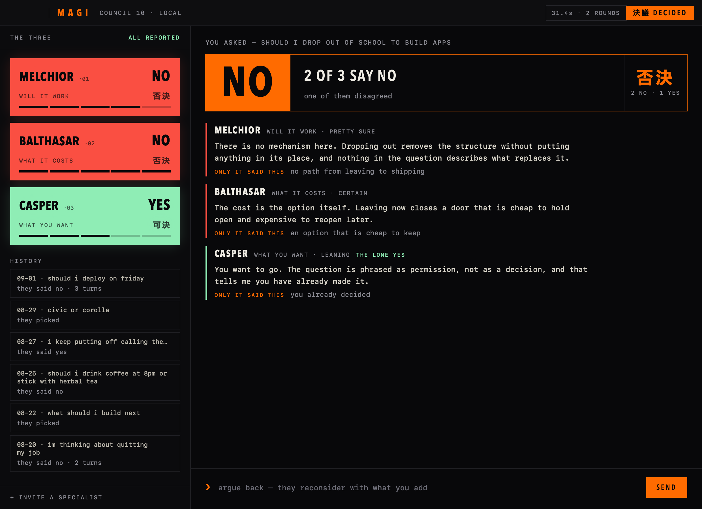

# MAGI

[](https://github.com/x0cero/magi/actions/workflows/ci.yml)
[](https://www.python.org/downloads/)
[](LICENSE)
[](https://discord.gg/KMWnFJ5tre)

A council that decides for people who can't. Three local models, three fixed lenses, one verdict you can argue with.



## What it is

You type the thing you can't decide. It does not have to be a question. "i keep putting off calling the dentist" works. Three members read it, each through a lens the others are not allowed to use, and vote:

- **MELCHIOR** asks whether it will actually work. Mechanism, numbers, second-order effects.
- **BALTHASAR** asks what it costs you. Reversibility, relationships, what gets sacrificed quietly.
- **CASPER** asks what you actually want. The one voice willing to say go.

They argue for a round or two, then land. Majority rules, a tie goes to whoever held their line harder, and a dead-even tie goes to CASPER, because when the arguments balance exactly, what you want is the deciding fact. There is no outcome that hands the question back to you.

Then you argue back. "i have a tested rollback and the whole team is on call" is new evidence for the running thread, not a new question, and the council re-votes on it. Every conversation is kept, so you can reopen one later and keep going.

Named for the three supercomputers in *Neon Genesis Evangelion*. The personas do not cosplay the show.

## Install

```bash
curl -fsSL https://raw.githubusercontent.com/x0cero/magi/main/install.sh | bash
```

That handles Python, Ollama and the three models (about 12GB). By hand:

```bash
pipx install magi-council
ollama pull qwen3:4b && ollama pull dolphin3:8b && ollama pull hermes3:8b
magi doctor
```

The package is `magi-council` because `magi` was taken on PyPI. The command is still `magi`.

### The Mac app

```bash
./mac/build.sh      # needs xcodegen (brew install xcodegen); installs to /Applications
```

The app owns no council logic. It runs `magi stream` and draws what comes back, so there is one implementation of the council and the eval harness measures the same code the app runs. See [mac/README.md](mac/README.md).

## Use

```bash
magi                                    # the terminal REPL
magi "should I take the job offer?"     # one-shot
magi -q "swift or flutter?"             # verdict line only, for scripts
magi --invite banker "should I move?"   # add a specialist to the council
```

In the REPL, a second line argues back. `/new` starts a fresh thread, `/journal` lists past ones, `/outcome <id> <what you did>` records what you actually did, and `/help` has the rest.

Three shapes of input are routed automatically: a yes/no decision, a choice between named options ("civic or corolla"), and an open ask for direction ("what should i build next"). Statements are read as the decision hiding inside them.

## Why it works the way it does

**It always decides.** Earlier versions reported any disagreement as "deadlock, your call", and 40% of deliberations ended that way. That was the bug. Refusing to vote is the worst thing a decision tool can do.

**Each lens is fenced.** Three models given the same question tend to produce one argument three times. Each member must produce a finding only its lens can produce, is told which arguments belong to the others, and is sent back if it repeats somebody else's point.

**It is not allowed to invent your situation.** Asked "should i push a database migration to prod at 5pm on friday", an earlier build voted yes because one member decided you had "a 24-hour rollback window with pre-migration testing in staging". You never said that. A member that asserts a fact your input never gave is sent back to answer from what you actually said.

**Small models on purpose.** Three seats share one GPU, so a round costs what the slowest seat costs. The default trio answers a round in about six seconds; a 14B trio took 87. Stronger models were measured and made fabrication worse, not better. If you have the hardware anyway, `magi --melchior qwen3:14b` or the config file.

## Bring a key instead

Any seat can run on a cloud provider. Prefix the model with the provider name and export the key:

```bash
export GROQ_API_KEY=gsk_...
magi --casper "groq/llama-3.3-70b-versatile" "should I move?"
```

| Prefix | Provider | Key | Free tier |
|---|---|---|---|
| *(none)* | local Ollama | none | yes |
| `ollama-cloud/` | Ollama Cloud | `OLLAMA_API_KEY` | yes |
| `groq/` | Groq | `GROQ_API_KEY` | yes |
| `openrouter/` | OpenRouter | `OPENROUTER_API_KEY` | free models |
| `gemini/` | Google Gemini | `GEMINI_API_KEY` | yes |
| `anthropic/` | Anthropic | `ANTHROPIC_API_KEY` | no |
| `openai/` | OpenAI | `OPENAI_API_KEY` | no |

If your local Ollama is signed in to ollama.com, `:cloud` tags work as bare names with no setup.

## Config

```bash
magi --init-config    # writes ~/.config/magi/config.toml with examples
```

```toml
[models]
casper = "groq/llama-3.3-70b-versatile"

[specialists]
invite = ["banker"]

[providers.groq]
api_key = "gsk_..."
```

Environment variables, all read fresh on every call:

| Variable | What it does |
|---|---|
| `MAGI_SOUND=0` | silence the console tones |
| `MAGI_SEED=1` | pin the sampler so two runs are comparable |
| `MAGI_NUM_CTX=16384` | context window (default 8192, keeps models from reserving gigabytes of cache) |
| `MAGI_CLASSIFIER_MODEL` | the small model that routes your input |
| `OLLAMA_HOST` | a non-local Ollama |

Everything lands in `~/.config/magi/`: the journal, the config, the cached tones.

## Is it any good? Run the evals

Twelve versions were tuned by feel, which is how the same bug got fixed twice. Now a fixed suite runs through the real pipeline and scores it mechanically, no LLM judge:

```bash
python -m evals run --seed 1 --out evals/runs/mine.json
python -m evals score evals/runs/mine.json -v
python -m evals band evals/runs/seed1.json evals/runs/seed2.json evals/runs/seed3.json
python -m evals compare evals/runs/before.json evals/runs/mine.json
```

It measures fabricated premises, lens overlap, decisive rate, vagueness, routing accuracy and latency. Seed your runs and measure the band before believing a delta: identical code has returned 12, 13 and 17 fabricated premises on three unseeded runs. Never compare numbers across machines; the same code scores differently on different Ollama builds.

`evals/runs/baseline-v0.12.json` is committed as the reference point. Full history in [CHANGELOG.md](CHANGELOG.md).

## Caveats

- Small models get arithmetic wrong. Trust the direction, not the figures.
- A tiebreak is close to a coin flip. When you see `CALL`, that is the answer to argue with.
- The fabrication detector is lexicon-based. Inventions in a domain it does not know still get through.
- Three is canon. Add perspectives through specialists, not a fourth seat.

## Contributing

See [CONTRIBUTING.md](.github/CONTRIBUTING.md).

## License

MIT. See [LICENSE](LICENSE).
