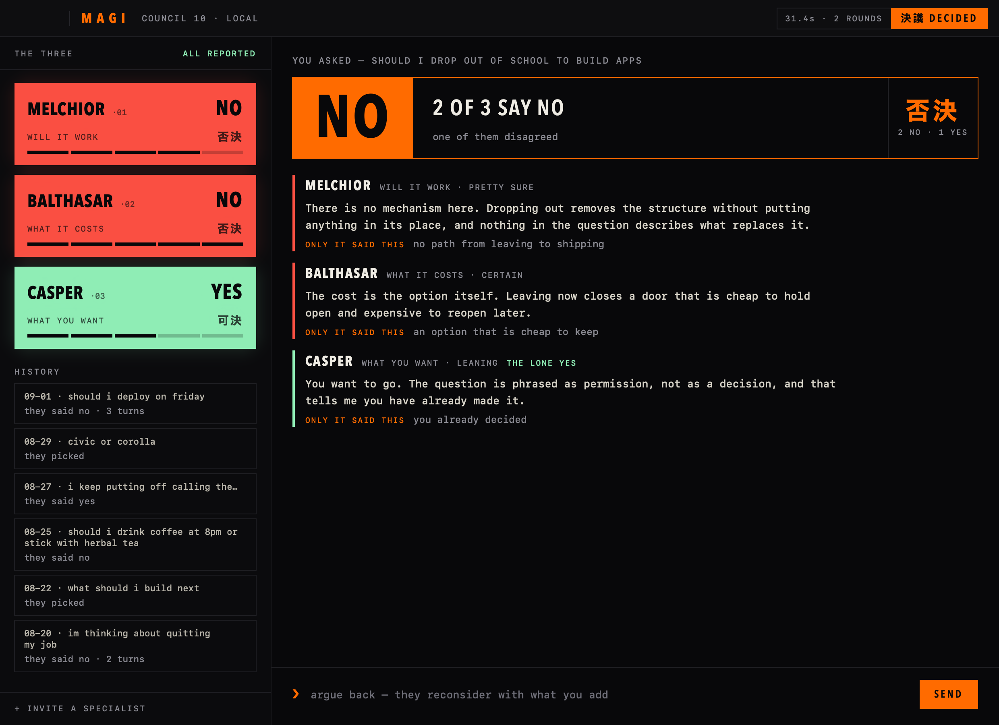

# MAGI.app

The council as a Mac app. Three seats down the left, the verdict and each
member's argument on the right, an argue-back line at the bottom, and every
past conversation in HISTORY to reopen and continue. The verdict takes the
whole screen for a moment when the council lands.



## Build

```bash
./mac/build.sh
```

Needs `xcodegen` (`brew install xcodegen`). Builds Release and copies the app
to `/Applications`. Ad-hoc signed, which is fine for a locally built app and
not fine for one that moves between machines.

## How it talks to the council

The app contains **no council logic**. It spawns the Python engine and reads
newline-delimited JSON from it:

```bash
magi stream "should i deploy on friday"   # one question, one event per line
magi stream                                # a session: one line per turn on stdin
magi roster                                # who is seated, for the idle display
```

The app keeps one `magi stream` session open per conversation. A follow-up is
written to its stdin and the engine treats it as evidence for the running
thread. `/new` on stdin drops the thread; `/resume <thread>` rebuilds a past
one from the journal, which is how HISTORY reopens a conversation.

That split is deliberate. The personas, the validators, the grounding rules and
the tie-breaking are 1,400 lines of Python that the eval harness measures. A
Swift reimplementation would be a second copy of all of it that no eval ever
scores, and the two would drift the first time a prompt changed.

The wire format lives in `magi/stream.py`, its tests in `tests/test_stream.py`,
and its Swift half in `mac/MAGI/Engine/Event.swift`. `PROTOCOL_VERSION` is
asserted on both sides; bumping it is a deliberate, matched change.

## Finding the engine

In order: a pinned `enginePath` default, `~/.local/bin/magi` (pipx), the repo's
own `.venv`, then Homebrew. So a dev checkout and a normal install both work
with nothing to configure.

## Screenshots without taking over the screen

```bash
MAGI.app/Contents/MacOS/MAGI --render shot.png --state answered   # idle | thinking | answered
```

Set `MAGI_JOURNAL_PATH` to a stand-in journal so the HISTORY column does not
show your own decisions.

## Settings

```bash
defaults write io.zeroarch.magi stampSeconds -float 5   # verdict hold, default 2.6
defaults write io.zeroarch.magi soundEnabled -bool false
defaults write io.zeroarch.magi enginePath "/path/to/magi"
```

## Sound

Cues are synthesised from arithmetic. Nothing is sampled from the show and
nothing is downloaded.

**Using your own audio.** Drop files here and they are played instead:

```
~/.config/magi/sounds/custom/
    boot.wav        the console coming up
    report.wav      one unit answering
    consensus.wav   all three agreed
    majority.wav    two of three
    tiebreak.wav    they split
    error.wav       something went wrong
```

Any format macOS reads works: wav, aiff, m4a, mp3, caf. Its own folder,
because the generated tones live one level up and get rewritten. Both the app
and the CLI check here first, so a file dropped in serves both. What you put
there is your business; this repo only reads the folder.

## How the built-in cues sound

Synthesised in the app from arithmetic, not sampled from the show. A unit
reporting clicks, a unanimous council resolves upward, a tiebreak does not
resolve. Audio failing to start is silence, never an error: a decision tool
must not fall over on a beep.
